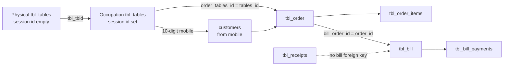

# Phase 2 legacy transaction mapping review

This review is for approval. It does not authorize an import.

The source is the restored staging database `varsity_source` on the Varsity server. Queries were read-only. The Laravel destination was not reset, and no legacy row was imported. Counts below are from that snapshot. Order dates run from 2026-04-19 through 2026-09-18. Bill dates cover the same span. The two receipts are dated 2026-09-30.

Phase 2 extends the existing full-refresh command. It does not add a second engine. One restore, one backup, one destination clear, then Phase 1 masters and Phase 2 transactions from the same snapshot. Maintenance mode stays on until the combined validation passes.

Phase 1 mappings are unchanged. One Phase 1 payment-code note cannot be reused for transactions. That is decision P2-1 below.

The customer rule below is approved. P2-1 through P2-17 are approved. P2-12 is conditionally approved and the conditions are implemented. Cancelled bills use `bills.status = cancelled`. Credit uses the seeded inactive `credit` payment method. Phase 2 runs inside `legacy:migration:full-refresh` after Phase 1, on the same restored snapshot. The live destination has not been refreshed by this implementation.

## Approved customer rule

The legacy POS stored a name and phone on each occupation row. It had no customer master. Laravel keeps one customer per phone.

1. Uniqueness is the normalized phone only. The name is never part of the key.
2. Every imported order with the same valid phone uses the same `customers.id`.
3. A different name on that phone does not create another customer.
4. The consolidated name is the latest non-empty name, ordered by `tbl_order.order_created_at` descending and then `tbl_order.order_id` descending.
5. If every name for that phone is empty, the consolidated name is `Guest`.
6. The name typed on an order is not written back onto the consolidated customer.
7. Phone normalization does not drop meaningful digits and does not merge distinct numbers. Invalid or ambiguous values are reported.
8. `customers.phone` is already `varchar(10)` and unique. No uniqueness migration is required.
9. Repeating a full refresh uses the same phone order and the same timestamp tie-breaker, so the same phone produces the same customer and the same orders point at it.

## Decisions that need approval

| ID | Decision | If rejected |
| --- | --- | --- |
| P2-1 | Approved. Legacy codes are 1 Cash, 2 UPI, 3 Split, 4 Non-chargeable, 5 Card, 6 Credit, 7 Cancel. The code map reuses the existing payment-method rows and does not change their ids. | — |
| P2-2 | Approved. One Laravel customer per normalized 10-digit phone. Names do not create extra customers. | — |
| P2-3 | Approved. The consolidated name is the latest non-empty order name. If every name is empty, use `Guest`. | — |
| P2-4 | Approved. `orders.customer_id` is nullable. The six orders import with a null customer. No phone is invented and no guest customer is created. Normal POS order creation still requires an active customer. | — |
| P2-17 | Approved. Nullable `orders.historical_customer_name` stores the name typed on that order. It is not a uniqueness key and is not updated when the customer master name changes. New orders leave it null. | — |
| P2-5 | Approved. Status 3 is take-away with `table_id` null. Status 2 is dine-in linked by `tbl_tbid`. Status 5 is `candle-light-dinner`. Both orders, their items, and their cash bills are imported. | — |
| P2-6 | Approved. All 1,317 imported orders become `checkout` with their historical timestamps. None stay `placed`. The ten unfinished orders also get `cancelled_at`. | — |
| P2-7 | Approved. One inactive waiter named `Legacy unassigned` receives the 704 orders with no importable waiter. `is_active` is false, so the account cannot authenticate. | — |
| P2-8 | Approved. Skip the 143 occupation rows that never received an order. They do not become tables, customers, or orders. | — |
| P2-9 | Approved. Do not import `tbl_tables_status`. Physical tables stay available. Historical orders are not operational. | — |
| P2-10 | Approved. Create bill lines from order items, excluding cancelled items (`kitchen_status` 3). Unit price is the stored `order_items_amnt`. | — |
| P2-11 | Approved. Preserve `bill_gd_total` as `bills.grand_total` and preserve stored item prices. Do not change a total or invent a payment so the figures match. | — |
| P2-12 | Conditionally approved. Code 6 is the inactive `credit` method, never cash, including the credit portion of a split. Code 7 sets `bills.status` to `cancelled` and `orders.cancelled_at`. The cancel payment row is not imported. Totals are not adjusted. | — |
| P2-13 | Approved. Reject the 14 bills with no order and the 40 items whose order is gone. Write an audit row for each. | — |
| P2-14 | Approved. Import the two banquet receipts and their items into `receipts` and `receipt_items`. Preserve amounts, GST flag, and dates. Do not link them to bills. | — |
| P2-15 | Approved. After a successful import, set the order sequence to 1416 and the bill sequence to 1397. Insert receipt ids 1 and 2 explicitly. | — |
| P2-16 | Approved. Exclude the 14 `TEST_SEED` bills and their 14 orders, 42 items, and 18 payments. Write one skip record per bill. Do not exclude a customer, product, or table only because a seed order used it. | — |

## 1. Legacy table inventory

| Legacy table | Rows | Class |
| --- | --- | --- |
| `tbl_users` | 9 | Phase 1. Seven users remain rejected under the approved rules. |
| `tbl_category` | 22 | Phase 1. |
| `tbl_products` | 377 | Phase 1. |
| `tbl_product_images` | 377 | Legacy-only. Phase 1 did not copy image files. |
| `tbl_tables` | 1,504 | Split. 30 rows are Phase 1 physical tables. 1,474 rows are Phase 2 occupation records. |
| `tbl_discounts` | 5 | Phase 1. |
| `tbl_order` | 1,331 | Phase 2 transactional. |
| `tbl_order_items` | 6,541 | Phase 2 transactional. |
| `tbl_bill` | 1,336 | Phase 2 transactional. |
| `tbl_bill_payments` | 1,265 | Phase 2 transactional. |
| `tbl_receipts` | 2 | Phase 2 transactional. Independent of bills. |
| `tbl_receipt_items` | 2 | Phase 2 transactional. |
| `tbl_orderpad` | 87 | Legacy-only scratch cart. Not placed orders. 12 rows point at a missing product. |
| `tbl_tables_status` | 925 | Legacy-only current-state log. See P2-9. |
| `tbl_tables_status_temp` | 203 | Legacy-only scratch copy. |
| `tbl_tables_notify` | 0 | Legacy-only. |
| `tbl_waiter_serve_table` | 878 | Legacy-only waiter shift log. No destination table. |
| `tbl_waiter_served` | 0 | Legacy-only. |
| `tbl_order_sufficient` | 0 | Legacy-only. |
| `tbl_rstdetails` | 1 | Legacy-only restaurant profile. Historical tax is already stored on each bill. Do not recompute it. |
| `tbl_combo` | 1 | Legacy-only. No combo products exist. |
| `tbl_combo_products` | 0 | Legacy-only. |
| `tbl_happy_hours` | 1 | Legacy-only. No destination price-rule table. |
| `tbl_happy_hours_products` | 1 | Legacy-only. |
| `tbl_grocery_category` | 6 | Legacy-only inventory. |
| `tbl_grocery_items` | 9 | Legacy-only inventory. |
| `tbl_grocery_item_batch` | 8 | Legacy-only inventory. |
| `tbl_grocery_item_order` | 0 | Legacy-only inventory. |
| `tbl_grocery_quantity_types` | 4 | Legacy-only inventory. |
| `tbl_grocery_debit` | 5 | Legacy-only inventory. |
| `tbl_vendor` | 0 | Legacy-only. |
| `tbl_dineprovendor` | 1 | Legacy-only gateway settlement log. |
| `tbl_dineqrpro` | 1 | Legacy-only. Contains bank and tax identifiers. Do not import or print them. |
| `tbl_payment_gateway` | 1 | Legacy-only. Contains gateway secrets. Do not import or print them. |
| `tbl_upipay` | 1 | Legacy-only UPI account. Phase 1 already excluded it. |

There is no legacy customer table. Customer identity is stored on occupation rows.

No other populated table carries POS sales. Grocery, combos, and happy hours are outside the restaurant order model.

## 2. Physical tables and occupation rows

`tbl_tables` holds both kinds of row. The ID boundary is not the rule.

Physical rows are exactly:

```sql
tables_session_id IS NULL OR TRIM(tables_session_id) = ''
```

That filter returns 30 rows. Their ids are 1–28, 36, and 37. Ids 29–35 are absent. Every physical row has a distinct `tbl_tbid`, a table number, no customer name, and no mobile. `tables_chair_numbers` is empty on all 30. This matches the Phase 1 import. Phase 1 must keep using this filter. Do not switch it to `tables_chair_numbers IS NULL`: 171 occupation rows also have empty chair numbers.

Occupation rows are the other 1,474. The smallest occupation id is 38. The largest is 1,575. Ids 36 and 37 were checked individually. Both are physical tables (numbers `PD` and `PL`), with no session, no customer, and no mobile. Id 38 is the first occupation row: it has a session, a `tbl_tbid`, a table number, a customer, and a 10-digit mobile. Id 39 is an occupation row with a session and a customer, and no `tbl_tbid` and no table number.

| Check | Result |
| --- | --- |
| Physical rows | 30 |
| Occupation rows | 1,474 |
| Physical rows that also have chair numbers | 0 |
| Occupation rows with no `tbl_tbid` | 170 |
| Occupation rows whose `tbl_tbid` matches exactly one physical row | 1,304 |
| Occupation rows whose `tbl_tbid` matches no physical row | 0 |
| Occupation rows with `tables_user_status` 1 | 170 |
| Occupation rows with `tables_user_status` 2 | 1,304 |

The 170 rows with no `tbl_tbid` are the counter seating inserts. The live counter insert writes only the customer name, mobile, session id, and user status. It does not copy a physical table. The 1,304 dine-in occupation rows copy `tbl_tbid`, `tables_number`, `tables_qr`, and `tables_desc` from the physical table at seating time.

A physical table has many historical occupation rows. The busiest physical `tbl_tbid` has 246 occupation rows. Every physical table in this snapshot has at least six.

An occupation row links back to its physical table by `tbl_tbid`, not by `tables_id`. `tables_id` is the occupation row's own primary key. `order_tables_id` points at that occupation primary key.

The live waiter transfer updates `order_table_id` and rewrites the latest occupation row's `tbl_tbid` and `tables_number` to the destination table. After a transfer, the occupation row no longer stores the original physical table. In this snapshot, every dine-in order's `order_table_id` still equals the occupation row's current `tbl_tbid`. The original table is not recoverable from these columns.

`order_segment` is not a usable classifier. It is null on 1,501 rows and `5` on 3 rows. The comment that says `2` is dine-in does not match the data.

## 3. Relationship diagram



Observed cardinalities:

| Relationship | Observed |
| --- | --- |
| Orders pointing at an occupation row | 1,331 of 1,331 |
| Orders pointing at a physical row | 0 |
| Orders whose session id differs from the occupation row | 0 |
| Orders per occupation row | 1,331 rows have one order. 143 have none. |
| Orders per session token | Every non-empty token has one order. |
| Occupation rows per session token | 1,472 tokens have one row. One token has two rows. |
| Bills per order | 1,322 orders have one bill. 9 have none. |
| Bills whose order id does not exist | 14 |
| Payments per bill | 1,195 bills have one, 28 have two, 1 has 14, 112 have none. |
| Payment rows without a bill | 0 |
| Merged-table orders | 1. Its single token matches a physical `tbl_tbid`. |
| Order-transfer history | Not stored. The transfer rewrites the occupation row. |

The extra occupation row on the shared session token comes from the merge insert, which copies the merged physical table into the same session. The order stays on the original occupation row. There is no split-bill structure: `bill_order_id` is unique, and no order has two bills.

## 4. Field mappings

Money columns stay `decimal` strings. Comparisons use a 0.01 tolerance only to classify rounding. They do not change stored values. Timestamps are copied when they parse. Empty legacy timestamps use the parent row's timestamp, and if that is also empty the row fails.

ID maps for occupation rows use the source name `tbl_tables_session`. They must not be written as `tbl_tables`. Phase 1 already owns `tbl_tables` plus the physical `tables_id`.

### Customers

Approved. Source rows are occupation records that have an imported order. There is no legacy customer primary key. The ID map source is `legacy_customers` and the source id is the normalized phone. Destination primary key: new `customers.id`, assigned by inserting phones in ascending order so a repeated refresh walks the same sequence.

A customer is created only from orders. Occupation rows that never became an order do not create a customer and do not affect the name.

Normalization, applied the same way on every run:

- Trim surrounding whitespace.
- Accept the value only when it matches `^[0-9]{10}$`.
- Do not strip a prefix, do not keep the last 10 digits of a longer value, and do not delete spaces, dashes, or other characters to force a match.
- Any other non-empty value is ambiguous or invalid. Report the order id and the reason. Do not merge it with a 10-digit phone.

This snapshot has 1,424 occupation mobiles that are already 10 digits. None use a `+91` prefix or another shape. Fifty occupation mobiles are empty. Six orders have no valid 10-digit phone. Those six are not given a customer by this rule.

| Source | Destination | Rule |
| --- | --- | --- |
| normalized `tables_mobile_number` | `phone` | The unique key. `customers.phone` is already unique at the database. |
| `tables_customer_name` on the winning order | `name` | Latest non-empty trimmed name for that phone. Order by `order_created_at` descending, then `order_id` descending. If every name is empty, store `Guest`. A name longer than 150 characters fails that phone and its orders. |
| — | `notes` | Null. Other names stay on the order, not in notes. |
| — | `is_active` | true |
| earliest and latest `order_created_at` for that phone | `created_at`, `updated_at` | Taken from the orders, not from occupation rows that have no order. |

74 phones were used with more than one distinct non-empty name, across 619 occupation rows. Those names do not create extra customers. Every imported order for a phone stores the same `customer_id`.

`orders.historical_customer_name` is a nullable `varchar(150)`. The migrator copies the trimmed occupation name into it. An empty name becomes null. Changing `customers.name` does not change this column. New POS orders do not fill it. Screens show this name when it is present, and otherwise show the customer master name.

### Orders with no valid phone

Six orders have an empty or non-10-digit occupation mobile. One of them has a name and five have neither a name nor a phone.

P2-4 is approved. Those orders import with `customer_id` null. Their typed name, when present, goes in `historical_customer_name`. The original phone text is not a customer phone. When the migrator is built, it may store that raw value only in `legacy_migration_id_maps.metadata` for the order, and it must not write it to `customers.phone`.

`customers.phone` stays required and unique. `StoreOrderRequest` and `OrderService` still reject a new order that has no active customer. Customer reports join `customers`, so these six orders stay out of that report instead of failing it. Order, bill, KOT, and print views tolerate a null customer.

### Orders

Source: `tbl_order.order_id`. Destination: new `orders.id`. `order_number` is the decimal text of `order_id`.

| Source | Destination | Rule |
| --- | --- | --- |
| `order_id` | `order_number` | Required. Unique because it is the source primary key. Max observed id 1,415. |
| occupation mobile | `customer_id` | The one customer for that normalized phone. Every order with the phone uses that id. The six orders without a valid phone use null. |
| `tables_customer_name` | `historical_customer_name` | Trimmed occupation name for this order. Empty becomes null. This does not change `customers.name`. |
| `order_user_status` | `dine_type_id` | 2 → `dine-in` (1,218). 3 → `take-away` (111). 5 → `candle-light-dinner` (2). |
| occupation `tbl_tbid` | `table_id` | Lookup the Phase 1 physical map metadata. Null for take-away. A dine-in row with no physical match fails. |
| `order_waiter_id` | `waiter_id` | Map through the Phase 1 user map. Legacy roles 2, 3, and 4 are Waiter when that user imports. Null, a missing user, a user rejected for another reason, or role 6 uses the one inactive `Legacy unassigned` waiter. |
| `tables_chair_numbers` | `pax` | The Order Wise PAX value. Empty stays null. Signed values, including the three negative chair counts, are stored on `orders.pax`. `allocated_seats` is set only when that count is from 1 to 255. |
| `tables_reserved_chair` | — | Not the Order Wise PAX column. It is not copied onto `orders.pax`. |
| `tbls_merged` | `merged_tables` | JSON array of destination table ids resolved from physical `tbl_tbid` tokens. The one populated value resolves. |
| `order_status` | `status`, `completed_at`, `cancelled_at`, `seating_cleaned_at` | Every imported order is `checkout`. Status 7 sets `completed_at` to the historical update time. Status 1, 2, and 6, ten orders, also set `cancelled_at` to that time. `seating_cleaned_at` is the same historical time for a dine-in order. It is never the import clock. |
| `order_created_at` | `started_at`, `created_at` | Copied |
| `order_updated_at` | `updated_at` | Copied. Also `completed_at` for status 7. |
| `order_spinstruction` | — | Copied onto each item only when the item instruction is empty. |
| `order_total_tax`, `order_grand_total`, `order_total_amnt` | — | Not stored. Order Wise Bill Summary uses `bills.subtotal` (`bill_total_amount`). PAX Average for a historical bill is that subtotal divided by `orders.pax`. |
| `discount_id`, `discount_amount`, `other_discount_comments` | — | Discount is stored on the bill. The order columns are validation context. |
| `print_status`, `order_vendor_name`, `notification_sent` | — | Unsupported operational flags. |

`order_table_id` is the physical `tbl_tbid` at the time of the last transfer, stored as text. It is not the destination table id. The join key is `order_tables_id`.

### Order items

Source: `tbl_order_items.order_items_id`. Destination: new `order_items.id`.

| Source | Destination | Rule |
| --- | --- | --- |
| `order_items_main_id` | `order_id` | Required. 40 items on 20 missing orders are rejected. |
| `order_product_id` | `menu_item_id` | Phase 1 product map. Zero items point at a missing product. |
| `order_items_qty` | `quantity` | Integer greater than 0. None fail in this snapshot. |
| `order_items_amnt` | `unit_price` | This is the unit price captured at sale, not the line total. The waiter insert binds `product_original_price`. All 6,541 values are numeric. 52 differ from the current menu price and must keep the stored price. |
| `item_packing_charge` | `packing_fee` | 34 items are non-zero. Null becomes 0.00. |
| `order_items_spinstruction` | `special_instructions` | Empty becomes null. Max length is not a destination limit. |
| `kitchen_status` | `status` | 0 → `pending` (847). 1 → `pending` (22). The live waiter control labels 1 “Order Placed”. 4 → `preparing` (10). 6 → `served` (5,657). 3 → `cancelled` (5). |
| `item_type` | — | Every row is `product`. |
| `order_items_user_status` | — | 2 or 3 with the parent order. 7 rows are 5 and inherit the parent decision. |
| timestamps | `created_at`, `updated_at` | Copied |
| — | `origin_order_id` | Null. Legacy items do not record a transfer origin. |

Line total for validation is `unit_price * quantity`. That product matches `order_total_amnt` on 1,301 orders and differs on 30. The 30 differences are reported. They do not change either side.

### Bills

Source: `tbl_bill.bill_id`. Destination: new `bills.id`. `bill_number` is the decimal text of `bill_id`. Max observed id is 1,396.

| Source | Destination | Rule |
| --- | --- | --- |
| `bill_order_id` | `order_id` | Numeric text equal to `tbl_order.order_id`. 1,322 match. 14 do not and are rejected. |
| `bill_total_amount` | `subtotal` | Preserved decimal. |
| `discount_id` | `discount_id` | Phase 1 discount map. `0` and null become null. 38 bills store `0`. No bill points at a missing or deleted discount id. |
| `discount_amount` | `discount_amount` | Preserved. Null becomes 0.00. 32 bills are non-zero. |
| `other_discount_value` | `other_discount_percentage` | Preserved. Null becomes 0.00. None are non-zero in this snapshot. |
| `other_discount_comments` | `other_discount_comment` | Empty becomes null. Truncate check at 255. |
| `taxable_total` | `taxable_amount` | Preserved, including zero. 463 bills are zero. Do not replace zero with a calculated value. |
| `bill_sgst + bill_cgst + bill_vat` | `tax_amount` | Sum of the stored components. Null components are 0.00 in the sum. |
| `additional_charges` | `additional_charges` | Preserved. 35 bills are non-zero. |
| `round_off` | `round_off` | Preserved. 673 bills are non-zero. |
| `bill_gd_total` | `grand_total` | Preserved. Payment reports use this tax-inclusive total. The Order Wise bill summary uses `subtotal` (`bill_total_amount`) for a historical order. |
| `grand_total` | — | Kept only in the reconciliation report. It differs from `bill_gd_total` on 1,095 bills. It is zero on 463 bills. |
| `bill_pay_status`, `bill_pay_method` | `historical_pay_status`, `historical_pay_method`, `status` | The Varsity bill-status label is the stored flag, in this order: method 4 or status 3 is Non Chargeable, method 6 or status 2 is Credit, method 7 or status 4 is Cancel, status 1 is Paid, otherwise Unpaid. It does not compare payment rows with `bill_gd_total`. Paid becomes `settled` without changing either amount. Credit, Non Chargeable, and Unpaid stay `open` and are excluded from live collection. |
| `bill_created_at` | `issued_at`, `created_at` | Copied |
| `bill_updated_at` | `updated_at` | Copied. `settled_at` uses the latest imported payment `paid_at` when the bill is settled. |
| `bill_table_id`, `bill_cust_session_id` | — | Validation only. On matched orders, the session id matches all 1,322. `bill_table_id` is empty on the 111 take-away bills and equals the occupation `tbl_tbid` on the other 1,211. |
| `payment_gateway`, `gateway_name` | — | Report labels only. 14 bills are `TEST_SEED`. |

The Varsity Order Wise report (`Report::new_order_wise_report`) prints `bill_total_amount` as Bill Summary and `tables_chair_numbers` as PAX. Its date is `order_created_at`. A historical Laravel bill, recognized by `historical_pay_method`, uses `bills.subtotal`, `orders.pax`, and `orders.started_at`. PAX Average is `subtotal / pax`. A new Laravel order still shows `grand_total`, its own `orders.pax`, and the bill timestamp. `orders.historical_order_total` and `orders.historical_chair_count` are not part of the schema.

`bill_pay_status` counts: null 2, paid 1,318, credit 2 is 15, non-chargeable 3 is 1, cancel 4 is 0. Status does not by itself settle the bill.

Nine orders have no bill. Eight of those are unfinished statuses 1, 2, or 6. One is status 7. No bill is created for them.

### Bill items

Legacy has no bill-item table. Each imported order item of an imported bill becomes one `bill_items` row.

| Source | Destination | Rule |
| --- | --- | --- |
| parent bill | `bill_id` | The bill of `order_items_main_id` |
| order item | `order_item_id` | Required |
| current `product_title` | `item_name` | The sale did not store a name. |
| `order_items_qty` | `quantity` | Same integer |
| `order_items_amnt` | `unit_price` | Same stored unit price |
| `item_packing_charge` | `packing_fee` | Same value |

### Bill payments

Source: `tbl_bill_payments.payment_id`. Destination: new `bill_payments.id`.

The live counter and waiter screens, and the 28 bills whose method is 3 and which each have exactly two payment rows, agree on this code list:

| Code | Live meaning | Destination |
| --- | --- | --- |
| 1 | Cash | `cash` |
| 2 | UPI | `upi` |
| 3 | Split | Not a tender. Do not insert a payment for the header or for a payment row with this code. |
| 4 | Non-chargeable | `non-chargeable` |
| 5 | Card | `card` |
| 6 | Credit | `credit`. Never `cash`. |
| 7 | Cancel | Not a tender. Do not insert the row. The bill status is `cancelled`. |

P2-1 is approved. `PaymentMethodMigrator` now records that live map by looking up the existing slug. It does not insert a payment method and it does not change a payment-method id, name, or active flag. Code 7 is recorded as cancellation and is not given a payment method. Credit stays inactive, so the counter payment list is unchanged. Phase 1 D11 followed the table comment and is not used for transactions.

Bill header counts: 1 is 310, 2 is 841, 3 is 28, 4 is 73, 5 is 77, 6 is 4, 7 is 3.

Payment row counts: 1 is 260, 2 is 832, 3 is 6, 4 is 61, 5 is 80, 6 is 23, 7 is 3.

| Source | Destination | Rule |
| --- | --- | --- |
| `bill_id` | `bill_id` | Required. No orphan payments. |
| `payment_method` | `payment_method_id` | Table above. Code 3 is skipped. Code 6 becomes `credit`. Code 7 is skipped. |
| `payment_amount` | `amount` | Preserved decimal. Null or negative fails that row. |
| `transaction_id` | `reference_number` | Empty becomes null. Max 150. |
| `payment_gateway` | `notes` | Gateway label only, never a secret. |
| `paid_at` | `paid_at`, `created_at`, `updated_at` | Copied |
| — | `captain_id` | Null. The payment row has no staff id. |
| `payment_status` | — | Report only. Counts: 1 is 18, 2 is 1,242, 3 is 2, 4 is 3. It does not change the amount. |

One bill has 14 payment rows. That distribution is preserved. It is not collapsed.

### Receipts

`tbl_receipts` has no bill, order, or customer foreign key. The Laravel receipt is the same kind of banquet document: date, customer name, mobile, program, pax, advance, balance, and an optional 5% GST flag. Import both rows there. Do not build receipts from bills. Receipt id 1 matches `bill_id` 1 only as a number: that bill is a 2026-04-19 UPI sale of 1,218.00. Receipt id 2 matches no bill.

| Source | Destination | Rule |
| --- | --- | --- |
| `receipt_id` | `receipts.id` | Preserve 1 and 2 so the printed number stays stable. |
| `receipt_date` | `receipt_date` | Required |
| `customer_name` | `customer_name` | Required. Both rows have a name. |
| `mobile` | `mobile` | Both rows are 10 characters. The destination allows 20. |
| `program` | `program` | Required text |
| `other_instructions` | `other_instructions` | Empty becomes null |
| `pax_count` | `pax_count` | Preserved |
| `advance_paid` | `advance_paid` | Preserved |
| `balance` | `balance` | Preserved |
| `include_gst` | `include_gst` | Preserved. The one flagged receipt matches 5% of its item total. The unflagged receipt does not, which is expected. |
| `gst_amount` | — | Not a destination column. GST is calculated from the flag. |
| timestamps | `created_at`, `updated_at` | Copied |

Receipt items copy `item_name`, `quantity`, `rate_price`, and `amount` unchanged. Both item amounts are the source values, not a recalculation. Each receipt has one item.

### Occupation rows that are not orders

143 occupation rows have no order. They include seating and reservations that never produced a sale. Laravel has no reservation table. They are counted and skipped. They do not become physical tables, customers without a phone, or empty orders.

`tbl_tables_status` points at an occupation `tables_id` on 920 rows, at a physical id on 5, and at a missing id on 4. Current undeleted rows are 11 occupied, 1 reserved, and 16 cleaning. Those are operational flags as of the dump, not a history of sessions. The last order is 2026-09-18. Importing them as live occupancy would mark tables busy. They are skipped.

## 5. Dependency order

Inside the existing full refresh, after the destination clear and the Phase 1 masters:

1. Customers.
2. The explicit `Legacy unassigned` user, only if P2-7 is approved.
3. Orders.
4. Order items.
5. Bills.
6. Bill items derived from order items.
7. Bill payments.
8. Receipts and receipt items.
9. Set `document_sequences` for `order` to 1416 and for `bill` to 1397.
10. Combined verification.

`DocumentNumberService` uses the stored sequence when the row exists. Full refresh currently sets it back to 1. Phase 2 must move it above the imported numbers or the next live order will reuse an imported number.

Occupation maps are written only for occupation rows that produce an order. Physical `tbl_tables` maps from Phase 1 are not updated.

## 6. Financial reconciliation

Validation reports these groups. It does not update the imported figures.

| Check | Snapshot result |
| --- | --- |
| Stored unit price equals current menu price | 6,489 |
| Stored unit price differs from current menu price | 52 |
| `unit_price * quantity` equals `order_total_amnt` | 1,301 |
| Line total differs from `order_total_amnt` | 30 |
| `bill_gd_total` equals `grand_total` | 241 |
| Those two totals differ | 1,095 |
| Payment sum equals `grand_total` | 834 |
| Payment sum equals `bill_gd_total` | 582 |
| Payment sum is within 1.00 of `bill_gd_total`, but not equal | 585 |
| Payment sum is more than 1.00 away from `bill_gd_total` | 169 |
| Bills with no payment rows | 112 |
| `taxable_total + SGST + CGST + VAT + additional + round_off` equals `grand_total` | 465 |
| Same formula does not equal `grand_total` | 871 |

The 585 near matches are reported as rounding candidates. The 169 larger gaps, the 112 unpaid bills, and the 30 line-total gaps are reported as inconsistencies. None of them receive a balancing payment or an edited total.

Settled means the imported tender sum, including credit and excluding cancel, equals the preserved `bill_gd_total`. A cancelled bill stays `cancelled` and is not settled. Short payments stay open. Credit is not added to cash. No payment or total is created to close a gap.

## 7. Missing-reference policy

| Missing reference | Count | Proposed handling |
| --- | --- | --- |
| Order with no 10-digit phone | 6 | Import with `customer_id` null. Do not invent a phone. |
| Order waiter null, unknown, or role 6 | 704 | One inactive `Legacy unassigned` user, if approved. |
| Order user status 5 | 2 orders, 7 items, 2 bills | Approved: `candle-light-dinner`. |
| Item kitchen status 3 | 5 | Import as `cancelled`. Exclude the item from derived bill lines and from quantity reports. |
| Item kitchen status 4 | 10 | Import as `preparing`. The parent order is historical checkout, so it is not a live kitchen ticket. |
| Item whose order is gone | 40 | Reject the item. |
| Bill whose order is gone | 14 | Reject the bill and its payments. |
| Product missing from Phase 1 | 0 on order items | No substitution. A future missing product fails the item. |
| Discount id `0` | 38 | Store null. |
| Physical `tbl_tbid` missing on a dine-in order | 0 | Fail the order if it appears. |
| Occupation row with no order | 143 | Skip. |
| Payment code 3 | 6 rows | Skip the payment row and report it. |
| Payment code 6 | 22 rows after `TEST_SEED` exclusion | Import as `credit`. |
| Payment code 7 | 2 rows after `TEST_SEED` exclusion | Skip the row. Set the bill to `cancelled` and the order `cancelled_at`. |
| `TEST_SEED` bills | 14 bills, 14 orders, 42 items, 18 payments | Skip and audit. One shared phone still keeps its genuine orders. |

Rejected rows are written to the existing migration error table. They are not attached to a nearby product, user, table, or order.

## 8. Source counts used for validation

| Source | Rows | Expected destination after the policies above |
| --- | --- | --- |
| Physical tables | 30 | Already imported by Phase 1. |
| Occupation rows | 1,474 | Not a destination table. |
| Customers | distinct valid phones on imported orders | One row per phone. Names do not add rows. |
| Orders | 1,331 | 1,317. Confirmed: 1,331 minus 14 `TEST_SEED` orders. The six phoneless orders and two Candle Light orders stay in. |
| Order items | 6,541 | 6,459. That is 6,541 minus 42 seed items minus 40 items whose order is gone. The 15 status-3 and status-4 items stay in. |
| Bills | 1,336 | 1,308. Confirmed: 1,336 minus 14 seed bills minus 14 bills with no order. 1,308 plus the 9 unbilled orders is 1,317. |
| Payments | 1,265 | 1,235 remain on the 1,308 bills. Skip 6 code-3 rows and 2 code-7 rows. Import 22 code-6 rows as `credit`. |
| Receipts | 2 | 2 banquet receipts. |
| Receipt items | 2 | 2 |

The final command must also confirm:

- each valid phone has one customer, and every imported order with that phone uses its `customer_id`
- the consolidated name matches the latest non-empty order name, with `order_id` breaking equal timestamps
- no order points at a session `tables_id` as if it were `tables.id`
- every dine-in `table_id` is one of the 30 Phase 1 tables
- every item price equals the legacy `order_items_amnt`
- every preserved `grand_total` equals the legacy `bill_gd_total`
- no destination order or bill number collides
- the next sequence values are 1416 and 1397
- Hot Beverages is still empty and Food still owns the Phase 1 menu

## 9. Approved transaction decisions

Counts below were read from `varsity_source` after removing rows whose `payment_gateway` and `gateway_name` are both `TEST_SEED`. No destination row was imported.

### P2-5 — Candle Light Dinner

Approved. The two status-5 orders map to `candle-light-dinner`. Their 7 items and two cash bills stay in the import. No schema change.

### P2-12 — Credit and Cancel

Conditionally approved, and the Laravel representation is in place.

A cancelled historical bill is `bills.status = cancelled`. `bills.status` is already a 30-character string, so no migration is required. The order is `checkout` with `cancelled_at` set, which the live floor and track-orders board already exclude. The legacy cancel payment row is not inserted. `grand_total` stays equal to `bill_gd_total`. Payment and billing services already refuse a bill that is not open, so a cancelled bill cannot be collected later.

After the seed exclusion, two bills remain: preserved totals 220.50 and 84.00, together 304.50. Their two payment rows sum to 305.00 and are not imported, so that 0.50 does not become cash.

Credit is a `payment_methods` row with slug `credit`. It is inactive, so the counter and admin payment screens do not offer it for a new settlement. Historical rows still use it. Split allocations stay as separate payment rows. A credit portion is not added to cash.

Payment-mode and waiter reports now sum cash, UPI, card, credit, and non-chargeable from payment rows. Cancel comes from `bills.grand_total` where the status is `cancelled`, and those bills are removed from net sales and from every tender column. The bill-status filter uses the same labels. A split that contains credit remains Paid, and its credit amount stays in the credit column.

Three genuine credit headers remain, totaling 827.28:

| Bill | Status | Preserved total | Credit payments |
| --- | --- | --- | --- |
| 1307 | Paid | 261.45 | 261.00 |
| 1383 | Credit | 315.00 | 315.00 |
| 1394 | Paid | 250.83 | 177.00 |

Bill 1394 is short by 73.83. That difference is not invented as a payment, and the preserved total is not reduced. The legacy credit column used the full preserved total for a credit header. Laravel reports the imported 177.00. Nineteen split credit rows remain, totaling 14,886.00. With the three header rows, 22 credit payments total 15,639.00.

Twelve bills whose pay status is Credit but whose method is cash, UPI, or non-chargeable keep that tender. Status 2 does not convert them.

### P2-14 — banquet receipts

Approved. Import both receipts and both items. Preserve the stored amounts, the GST flag, and 2026-09-30. Do not attach either receipt to a bill, and do not generate receipts from bills. No schema change.

### P2-16 — TEST_SEED exclusion check

Approved. The 14 bills are a closed set:

- 14 distinct orders, and every one of those orders exists
- no seed order has a second bill
- 42 items, all on those orders
- 18 payments totaling 17,994.00, all on those bills
- both gateway fields are `TEST_SEED` on all 14, and no other bill has that label on only one field
- the two Candle Light orders are not in the set

One normalized phone appears on a seed order and on a genuine order. The customer for that phone stays. Only the seed order, its items, its bill, and its payments are skipped.

### Totals after exclusion

| Group | Bills | Preserved `bill_gd_total` |
| --- | --- | --- |
| Cash header | 302 | 304,084.59 |
| UPI header | 833 | 1,062,121.71 |
| Split header | 24 | 44,923.05 |
| Non-chargeable header | 69 | 35,332.05 |
| Card header | 75 | 171,794.35 |
| Credit header | 3 | 827.28 |
| Cancel header | 2 | 304.50 |
| Importable bills | 1,308 | 1,619,387.53 |

The header figures are the legacy report buckets. They are not rewritten from payment rows. Payment rows on those 1,308 bills are 1,235 and sum by code to: cash 295,784.00 (250), UPI 1,063,107.00 (822), code 3 2,137.00 (6, skipped), non-chargeable 51,243.00 (57), card 171,765.00 (76), credit 15,639.00 (22), cancel 305.00 (2, skipped).

Legacy-style net sales of the 1,308 bills is preserved total minus non-chargeable headers minus cancel headers: 1,583,750.98. Credit stays inside that figure and outside cash.

### Order and bill reconciliation

1,331 source orders minus 14 seed orders is 1,317. 1,336 source bills minus 14 seed bills minus 14 bills with no order is 1,308. The 1,317 orders are the 1,308 billed orders plus 9 orders that have no bill. The two Candle Light orders are inside the 1,317. P2-6, P2-7, P2-8, P2-9, P2-10, P2-11, P2-13, and P2-15 do not remove any of those orders or bills.

### Kitchen statuses 3 and 4

The live waiter screen labels value 3 “Cancel” and value 4 “Preparing”. Reports, bills, and checkout totals exclude status 3. The column comment that says 3 and 4 are undefined is older than that screen.

All 15 rows belong to finished, non-seed orders, so they stay inside the 1,317 orders. Status 3 is five items from 2026-08-05 through 2026-08-11, line amount 655.00, mapped to `cancelled`. Status 4 is ten items from 2026-04-19 through 2026-05-15, line amount 3,045.00, mapped to `preparing`. Neither set is a live ticket once the parent order is historical checkout.

## 10. Historical floor and kitchen

The legacy kitchen queue is an order whose status is not 6 or 7 and whose created time is inside the last 24 hours. Laravel has no kitchen-ticket table. A table is occupied only by an order that is `placed` with no completion and no cancellation, or by a checkout order whose cleaning window is still open. KOT editing requires that same active order.

The approved import keeps every historical order as `checkout`. The ten unfinished orders, none of which are `TEST_SEED`, also receive `cancelled_at`. Dine-in orders receive `seating_cleaned_at` equal to their historical update time. `tbl_tables_status` and occupation rows are not written onto `tables.status`. The 143 occupation rows with no order are skipped. An order item left `pending` or `preparing` therefore has no placed order and no open cleaning window, so it does not occupy a table and it is not a live kitchen ticket.

A checkout order with an open historical bill can still appear on Track Orders. That board lists open bills without a date limit. It does not mark the table occupied and it does not open KOT editing.

## 11. Unresolved items

These do not change the approved order or bill counts.

- `payment_status` 1, 3, and 4 are not defined tightly enough to change a payment amount.
- Transfer history cannot be rebuilt. The occupation row keeps only the latest physical table.
- `tbl_orderpad` is a cart. It is not an order, and 12 lines have no product.
- Grocery, combo, happy-hour, vendor, gateway, and waiter-shift tables have no POS destination.
- The raw invalid phone for the six phoneless orders is stored only in the order ID-map metadata. It is not written to `customers.phone`.
- 169 bills differ from their payment sum by more than one rupee. The correct business total is not knowable from the columns alone beyond preserving `bill_gd_total`.

## 12. Implementation

`App\Services\LegacyMigration\TransactionMigrator` runs from `MasterDataMigrator` after the Phase 1 migrators, in the same context. It writes customers, orders, order items, bills, bill items, payments, receipts, and receipt items. Occupation rows are not imported as tables. A dine-in order resolves `order_tables_id` to the occupation row, then `tbl_tbid` to the Phase 1 physical table.

Customers are inserted in phone order. The source id in the ID map is the 10-digit phone. Orders without a valid phone keep `customer_id` null. `orders.historical_customer_name` keeps the name typed on that occupation. The consolidated name is the latest non-empty name from non-seed orders. A phone that also appears on a `TEST_SEED` order still creates one customer from the genuine orders.

Settled bills set `settled_at` from the latest imported tender `paid_at`. Cancelled bills stay `cancelled` and their payment rows are not collected. Split rows (code 3) are not tenders. Credit rows stay Credit. Document sequences move to one past the largest source order id and bill id, including excluded rows, so the next live number does not reuse a historical number.

The current snapshot, checked read-only and not imported, matches the approved totals: 1,317 orders, 6,459 order items, 1,308 bills, preserved total 1,619,387.53, legacy-style net sales 1,583,750.98, 22 credit rows totaling 15,639.00, and 2 receipts. Those numbers are snapshot facts. The migrator does not hardcode them.

169 non-seed bills differ from the sum of every payment row by more than one rupee. Five of those bills are orphans and are excluded. The other 164 are imported with `bill_gd_total` unchanged. That difference is reported as `payment_gaps_over_one_rupee` and is not an import failure. Bill 1394 remains short by 73.83.

A dry-run against the live Laravel database was not run. Dry-run still writes migration tracking rows, so the snapshot check above used SQL on `varsity_source` only. Do not run `--approve-reset` until that destination is the one you intend to replace.

## Full-refresh shape

The approved run stays one operation:

1. Restore the latest Varsity dump into `varsity_source`.
2. Analyze and dry-run Phase 1 and Phase 2 together.
3. Back up the Laravel database.
4. Turn maintenance mode on.
5. Clear the approved business tables once.
6. Recreate system masters.
7. Run Phase 1.
8. Run Phase 2 in the order above.
9. Rebuild ID maps.
10. Validate counts, foreign keys, and financial totals.
11. Move the document sequences.
12. Turn maintenance mode off only when validation passes. A failure restores the backup.

No second reset runs between the phases.
